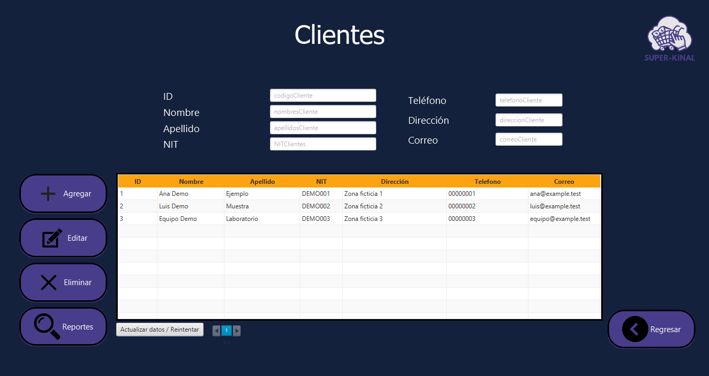
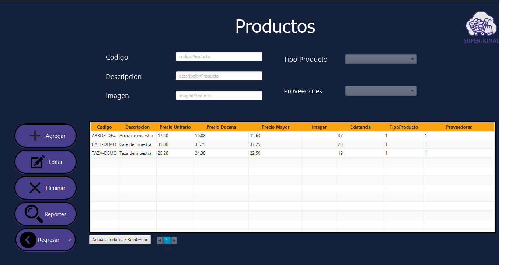
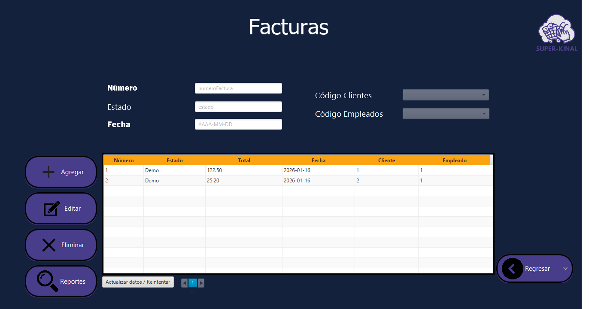

# Demo reproducible con datos sintéticos

El perfil de demo crea un servidor MySQL privado en loopback con un directorio nuevo bajo `work/mysql-demo-<id>` y un puerto diferente al habitual. Crea `superkinal_demo`, compila el JAR, carga los datos ficticios y captura las vistas JavaFX reales. La demo no conecta a la base personal ni la modifica.

## Ejecutar

Requisitos: JDK 8 con JavaFX, Maven 3.9+, MySQL Server 8.0.16+. Configurar JAVA_HOME y PATH como indica el README principal.

```powershell
.\scripts\demo.ps1 -MySqlBin 'C:\Program Files\MySQL\MySQL Server 8.0\bin'
```

Si Maven no está en PATH, pasar `-Maven 'ruta\a\mvn.cmd'`. Para generar solo capturas sin abrir una ventana usar `-CaptureOnly`. Para producir además un video de nueve segundos de las capturas, instalar FFmpeg desde su distribución oficial y pasar `-Ffmpeg 'ruta\a\ffmpeg.exe'`. Se necesita una distribución completa con lector PNG, demuxer concat y encoder libvpx.

La app se abre con el formulario de login. Usuario **demo**, clave ficticia **Demo-Kinal-2026!**. El registro de base guarda un hash PBKDF2, no esa clave en texto plano. Ninguna credencial de esta demo debe usarse fuera del laboratorio. El servidor privado se apaga cuando se cierra la aplicación. Los archivos de datos se conservan bajo work, ignorados por Git; cada nueva ejecución crea una instalación limpia.

## Recorrido

1. Iniciar sesión y abrir Clientes: tres personas ficticias con correos reservados example.test.
2. Abrir Productos: café, arroz y taza con existencias y precios calculados desde compras.
3. Abrir Facturas: dos ventas ficticias. La primera totaliza Q122.50; la segunda Q25.20.
4. Consultar los detalles: 2 cafés y 3 arroces en la primera venta. Existencias finales: 28 cafés, 37 arroces y 19 tazas.
5. Generar un reporte. Esta es una aplicación académica; no emite facturación electrónica ni un comprobante fiscal válido.

`DemoCapture` renderiza los FXML y las consultas reales del programa. Las imágenes no son mockups. El video es una secuencia de esas tres vistas, no una grabación de una persona operando el programa.

## Evidencia







[Video de las capturas](recorrido.webm). Los comandos, resultados y límites de la verificación están en `../evidence/demo-validation.md`.
